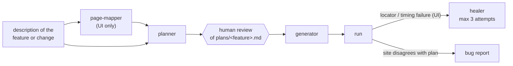

# qa

[](https://github.com/benweese/claude-plugins/actions/workflows/validate.yml)

A [Claude Code](https://claude.com/claude-code) plugin, `qa` (from the [benweese marketplace](../../README.md)), that turns "test this feature" into reviewed, runnable Playwright tests in TypeScript. Agents plan the scenarios, stop for a human to review the plan, then write the API clients, page objects and specs, run them, and repair broken UI locators within a fixed budget.

**[Docs site](https://code.benweese.com/claude-plugins/)** (this README, the worked example and the changelog)

By **[Ben Weese](https://benweese.com/)** · more projects at **[code.benweese.com](https://code.benweese.com/)**

## How it fits

It is one of three repos that work together:

| Repo                                                                           | Role                                                                                                |
| ------------------------------------------------------------------------------ | --------------------------------------------------------------------------------------------------- |
| [playwright-test-commons](https://github.com/benweese/playwright-test-commons) | Shared framework code the generated tests use                                                       |
| **claude-plugins** (this repo)                                                 | The Claude Code plugin (`qa`, in the `benweese` marketplace)                                        |
| [playwright-e2e-demo](https://github.com/benweese/playwright-e2e-demo)         | A real suite for [automationexercise.com](https://automationexercise.com), written with this plugin |

## The workflow



The plan opens with numbered acceptance criteria (`AC-1`, `AC-2`, ...), and each scenario lists the criteria it covers. Each scenario also gets an id, a number unique across the repo (`#0012`), that goes into its test title. Ids don't encode the kind of test; tags such as `@smoke`, `@api` and `@ui` do. A failing test points straight back to its written steps, its expected result and the requirement behind it.

[docs/worked-example.md](docs/worked-example.md) follows one real feature, the cart in playwright-e2e-demo, through every stage, from page map to the healer's final diff.

## Requirements

- [Claude Code](https://claude.com/claude-code)
- A test repo laid out like [playwright-e2e-demo](https://github.com/benweese/playwright-e2e-demo) (see [What the test repo needs](#what-the-test-repo-needs))

## Install

From a terminal, in the test repo (one step; Claude Code 2.1.275 or later):

```bash
claude plugin install qa --marketplace benweese/claude-plugins
```

Or in two steps, which also works on older versions:

```bash
claude plugin marketplace add benweese/claude-plugins
claude plugin install qa@benweese
```

Where your client has the `/plugin` command (the VS Code extension doesn't), `/plugin install qa --marketplace benweese/claude-plugins` does the same. Add `--scope project` to record it in the repo's `.claude/settings.json` for everyone who opens it. Recording it in `.claude/settings.json` alone didn't load it in the VS Code extension, only after the terminal install, so keep the terminal steps in the test repo's README.

**Plugins load when a session starts.** After installing, start a new Claude Code session before using the agents. In VS Code, run **Developer: Reload Window** from the command palette, or open a new Claude Code tab.

**Upgrading from `playwright-qa-agents` (0.x):** the plugin was renamed `qa` and the marketplace `benweese` in 1.0.0. Uninstall the old one (`claude plugin uninstall playwright-qa-agents@playwright-ai-qa-agents`), then install as above. Skills are now `/qa:<skill>`; `check` moved to the `workflow` plugin and `update-docs` to the `docs` plugin.

To pick up a new version, run `claude plugin update qa@benweese` (or `/plugin update`), then start a new session.

### Check it loaded

Claude Code no longer has an `/agents` command. Instead, ask Claude in the new session:

```
List the subagents and skills from the qa plugin.
```

It should name six agents (`page-mapper`, `api-test-planner`, `ui-test-planner`, `api-test-generator`, `ui-test-generator`, `ui-test-healer`) and the skills in the [Skills](#skills) table, each prefixed `qa:`. If it finds none, the plugin isn't installed or the session started before the install: run `claude plugin list` in a terminal, then start a new session.

### What the test repo needs

- The layout used by playwright-e2e-demo: `api/` clients, `tests/api/` and `tests/ui/` specs, `schemas/`, `plans/` and `docs/pages/`
- TypeScript, with `playwright.config.ts` at the repo root
- **Optional, recommended:** [playwright-test-commons](https://github.com/benweese/playwright-test-commons) v0.7.0 or later (typed API responses, numeric test ids, the `BasePage` checks, accessibility scan and `uniqueEmail` the generators use). Without it, the plugin copies the same helpers into the repo — see [Using qa without commons](#using-qa-without-commons)
- `@playwright/cli` as a dev dependency, for the agents that drive a browser
- `npm run lint` that includes the type-check (and ideally JSDoc rules)
- A `CLAUDE.md` describing the repo's rules, helpers and site quirks, ideally split into a short root file and a guide per folder (`api/`, `tests/api/`, `tests/ui/`, `plans/`, ...) so each session loads only what it needs. Agents follow them over their own defaults

### Using qa without commons

When `@benweese/playwright-test-commons` isn't in `package.json`, the generators copy commons' helpers into the repo instead, with `qa-support` (on Claude's PATH while the plugin is enabled):

- **Two commons bundles, copied only when needed:** `core` (API work, titles and tags: `ApiBase`, `getBody`, `errorCheck`, `pollUntil`, `validateJsonSchema`, `createJsonSchema`, the date helpers, `uniqueEmail`, `generateTestDescription`, `TAGS`) and `ui` (`BasePage`, `expectNoA11yViolations`, `scanA11y`).
- **Where:** `tests/support/` by default, or `.claude/qa.json` `"supportDir"`. Tests import the copy with relative paths (`../support/index.js`, `../support/ui.js`).
- **TypeScript or JavaScript:** the TypeScript sources if the repo has a `tsconfig.json`, otherwise commons' compiled `.js` with `.d.ts` types.
- **devDependencies:** `qa-support plan` lists what the helpers need (`ajv`, `ajv-formats`, `genson-js`, `dayjs` for core; `@axe-core/playwright` for ui; `@types/node` for TypeScript), skipping anything already installed at a compatible version and never downgrading. Claude shows you the list and **waits for your yes** before touching `package.json`.
- **Updates:** each copy starts with a header naming the commons version and the file's hash. Later, an unmodified older copy can be refreshed with `qa-support update`; a copy you've edited is left alone. Nothing is ever overwritten, and a file `qa-support` didn't write stops the copy.
- The helpers are generated from one pinned commons version (see `templates/commons/manifest.json`).
- A third bundle, `a11y`, is the qa plugin's own (see [Accessibility tests](#accessibility-tests)); it's copied the same way, with or without commons.

**Test id check in CI:** that's `check-test-ids`, which stays in commons. For an id check in CI, install playwright-test-commons and run `check-test-ids`.

## Usage

Start the whole flow with a description of the feature or change, a page URL, or a path to a requirements file:

```
/qa:author-tests the product search page and POST /api/searchProduct
```

It maps the page, drafts `plans/<feature>.md` and **stops for your review**. Once you approve the plan, it generates the tests, runs them, and heals UI locator failures.

### Agents

| Agent                                  | Job                                                                                                                                                                                                                                                                                                                                                                                                                                                        |
| -------------------------------------- | ---------------------------------------------------------------------------------------------------------------------------------------------------------------------------------------------------------------------------------------------------------------------------------------------------------------------------------------------------------------------------------------------------------------------------------------------------------- |
| `page-mapper`                          | Walks one live page with `playwright-cli`, in its own browser session, and documents its controls, input behaviour, URL params, validation, success, empty and error states, and multi-page flows in `docs/pages/<page>.md`. It records what the page does today, and flags what looks like a bug                                                                                                                                                          |
| `api-test-planner` / `ui-test-planner` | Turn the description into numbered acceptance criteria, then hand-runnable scenarios that cover them. They check existing tests and clients first, so nothing is duplicated or invented. The API planner lists the schemas needed and leaves undocumented negative cases as open questions; the UI planner writes expected results from the requirement, not the page, lists the differences as expected findings, and checks every element can be located |
| `api-test-generator`                   | Writes the spec and any planned client methods (typed and documented), generates and tightens JSON schemas with `UPDATE_SCHEMAS=true`, lints and runs                                                                                                                                                                                                                                                                                                      |
| `ui-test-generator`                    | Checks the plan was approved, then writes locators → page object → spec, using the locators the live page actually exposes, in its own browser session. Deletes anything it creates while exploring                                                                                                                                                                                                                                                        |
| `ui-test-healer`                       | Fixes drift, ambiguity and timing failures, one test at a time, in its own browser session, with at most 3 attempts per test. Marks plan-vs-page mismatches `test.fixme()` instead of changing the assertion                                                                                                                                                                                                                                               |
| `component-tester`                     | Writes component tests in the runner the repo already uses (see [Component tests](#component-tests)): states and variants, not flows, with accessibility checks on every state. Never picks or installs a runner |
| `a11y-tester`                          | Writes and runs `tests/a11y/<page>.a11y.spec.ts` for one page (see [Accessibility tests](#accessibility-tests)). Test code only: a real accessibility bug stays a failing test and goes in the report |

### Skills

| Skill | Use |
| ----- | --- |
| `/qa:author-tests <feature>`           | The full flow above |
| `/qa:run-spec <path \| project \| id>` | Run a spec, a project (`smoke`, `api`, `ui`) or one test by id (`12` or `#0012`), and summarize |
| `/qa:bug-report <description>`         | Write a bug report to `bugs/`, using the test and plan if a test id is given |
| `/qa:review-tests [issue <n> \| file <path>]` | Check the tests against the original request: gaps, scope creep, weak tests (report only) |
| `/qa:playwright-cli`                   | Playwright's own skill for driving a browser with `playwright-cli`, used by the page-mapper, UI generator and healer (see below) |

Lint (`/workflow:check`) and docs upkeep (`/docs:update-docs`) are in the [workflow](../workflow/README.md) and [docs](../docs/README.md) plugins.

## Accessibility tests

Ask for accessibility tests for a page (or run the `a11y-tester` agent) and it writes `tests/a11y/<page>.a11y.spec.ts`:

- **Axe** at the repo's WCAG target, as the page loads and in each state with new content (an open dialog, a failed submit). Set the target in `.claude/qa.json`; the default is 2.2 AA:
  ```json
  { "version": 1, "a11y": { "wcag": "2.2", "level": "AA" } }
  ```
- **Keyboard:** the key elements of each task are reached by Tab in order (their relative order, not the page's full tab sequence), controls show a visible focus indicator, and dialogs keep focus inside, close on Escape and return focus to the button that opened them.
- **ARIA snapshots** (`toMatchAriaSnapshot`, saved as files) of stable regions only: landmarks, forms and dialogs, never whole pages with prices, dates or counts. **You review each new baseline**; it records what the page does today, bugs included.
- **User preferences:** reduced motion, more contrast and forced colors.
- **Reflow:** 320 CSS px wide with the root font at 200%. That's an **approximation** of the OS text setting and browser zoom, labelled as one. It fails on sideways scrolling or clipped text. Text with fixed px font sizes can't grow with the root, so it's reported as a finding, not a failure.

The report lists failures (with the WCAG criterion and what a user would hit), findings, the baselines to review, and a short list to **check by hand** (screen reader, real 200% text and 400% zoom, whether alt text makes sense, reading order, voice control). When nothing fails it says "no automated violations found", never "accessible": automated checks cover only part of WCAG.

The keyboard, media and reflow checks are the qa plugin's own `a11y` bundle (`expectTabOrder`, `expectVisibleFocus`, `expectFocusTrapped`, `expectEscapeCloses`, `withMedia`, `expectReflow`), copied into the support folder with `qa-support install --bundle a11y`, even when commons is installed. It's JavaScript with `.d.ts` types, so the same files work in TypeScript and JavaScript repos. Axe scans use commons' `expectNoA11yViolations` (or the `ui` copy).

## Component tests

Ask for component tests (or run the `component-tester` agent) and it:

1. **Finds the runner the repo already uses**, with `qa-components detect`: Playwright's built-in `mount` with a story gallery (Playwright 1.62+), Storybook's test runner or Vitest addon, Vitest browser mode, or Vitest / Jest with jsdom and Testing Library. **It never picks one:** with none set up, it lists the options and asks. Playwright's old `@playwright/experimental-ct-*` packages were removed in 1.63; it points you to the migration guide first.
2. **Reads Playwright's own component-testing skill from your `node_modules`** (`playwright-core/lib/tools/skills/playwright-component-testing/`). It ships with `@playwright/test`, so it always matches your version; the plugin doesn't bundle or link it.
3. **Finds untested states.** `qa-components coverage` lists stories (`*.story.*`) that no test mounts, mounts of stories that don't exist, and common states with no story. It checks the component's props and code too: default, empty, loading, error, disabled and variants. An untested error state is the usual gap.
4. **Writes one test per state, never a flow.** Navigating away from the component, chaining goals or calling the real backend belongs in e2e; `/review-tests` flags a component test that does any of those as scope creep.
5. **Checks accessibility on every state it renders:** axe at your WCAG level and the `a11y` bundle's keyboard checks (Playwright), Storybook's a11y addon, or axe-core in jsdom (where the report says contrast, focus and reflow can't be checked).

`.claude/qa.json` can point it at other folders: `{ "version": 1, "components": { "storiesRoot": "src", "testDir": "tests" } }` (those are the defaults).

## Test-file hook (opt-in)

After Claude edits a Playwright test file (`*.spec.ts`, `*.test.ts`, and the `.js` / `.mjs` / `.cjs` versions), the hook:

1. finds the nearest `playwright.config.{ts,js,mjs,cjs}` at or above the file (so a suite in `e2e/` works);
2. from that folder, runs the project's own ESLint on the file, then `playwright test --list <file>`;
3. on a failure, hands the output back to Claude to fix (the edit stays); otherwise shows a one-line note with the elapsed time.

It uses only the project's `node_modules/.bin` tools and never downloads anything. If ESLint or `@playwright/test` isn't installed it says the check was skipped; it stops after 60 seconds. Outside a Playwright folder it does nothing.

**It's off until a project opts in**, because Claude Code runs a plugin's hooks in every project where the plugin is enabled. Add `.claude/qa.json` to the test repo:

```json
{ "version": 1, "hooks": { "lintAfterEdit": true } }
```

A missing or invalid file means off.

## Review tests against the original request

`/review-tests` checks the tests for the current task against **what was actually asked**, not a summary of it:

1. **The request is saved at the start** (`author-tests` does it; or `qa-requirements save chat|issue <n>|file <path>`) in `.claude/qa/requirements.md`, verbatim, with its source, git branch and date. **Gitignore `.claude/qa/`** — you're warned on every run until you do.
2. The **test-reviewer** agent reads only that file and the tests, in a fresh context. The plan is used to map scenario ids, never as the requirement — a difference between plan and request is reported.
3. It reports **decisions first** (add / cut / fix / ask), then requirement → test → status (covered / partial / gap / ambiguous), extras (useful-keep / scope creep / wrong) and weak tests (ones that wouldn't fail if the feature broke). It never changes a test.

No written requirement ("go test this page")? Claude restates it as a numbered list and waits for your yes first. Two sources that disagree? It asks which one wins.

**Requirement sources** are swappable: chat, GitHub issue and file are built in. The file format is the contract — another plugin adds a source (a tracker, say) by writing `.claude/qa/requirements.md` in the same format:

```
<!-- qa-requirements v1 -->
source: <name>
ref: <id or path>          (optional)
branch: <git branch>
saved: <ISO date>
---
<the request, verbatim>
```

**Auto-review (opt-in):** `author-tests` already runs the review when the suite goes green. As a safety net for green runs outside it, add `"autoReview": true` to `.claude/qa.json`:

```json
{ "version": 1, "hooks": { "lintAfterEdit": true, "autoReview": true } }
```

After a green test run (`playwright test`, `npm test`, … — not `--list`, `--help`, `show-report` or `codegen`), Claude is asked to run `/review-tests`: once per green run, only if the test files changed since the last review, at most twice per task (then only when you ask). A new request or a different branch starts a new task. Off by default.

## Guardrails

These rules exist because AI test authoring fails in predictable ways:

- **Plan, review, then generate.** Duplicate scenarios, untestable criteria and wrong assumptions are cheapest to catch in a plan, before code exists.
- **Assert the plan, not what you see.** An agent driving a live site will happily encode a bug as expected behaviour. Generators keep the plan's assertion, leave the test failing, and report the difference. The healer never changes an assertion to match the page: it marks the test `test.fixme()` with the expected and actual result, so the suite stays green while the bug is tracked in the test itself.
- **A healing budget.** Three attempts per test, then a `// Fixme:` note saying what was tried. Without a limit, a healer flips between locators forever.
- **Two-tier locators.** Elements are acted on through `getBy*`, plus whatever the test repo's `tests/ui/CLAUDE.md` also allows (such as stable `data-*` attributes). When no good locator is unique on its own, the agent scopes to a good container first (the nearest meaningful parent, such as a form, dialog, row or card) and finds the element inside it. No XPath, generated class names or `.nth()`.
- **Parallel, not serial.** Following Playwright's best practice, every test is isolated and can run in parallel. One failure in a serial block skips the rest and hides what they'd find, so a dependent journey is one test with a `test.step` per stage, and tests that share data create it per worker.
- **Clean up and go easy on shared sites.** Each agent uses its own named browser session, records and deletes any account or record it creates, and never raises the worker count against a site other people use.
- **Shared helpers go to commons.** A helper any site could use belongs in playwright-test-commons, not the test repo; generators report it as a commons candidate instead of adding a local helper file.
- **The test repo's `CLAUDE.md` wins.** Agents read the repo's own rules, helpers and site quirks before applying their defaults, so the plugin works across different suites.

## What review caught

These cases come from building [playwright-e2e-demo](https://github.com/benweese/playwright-e2e-demo) (54 tests plus setup and teardown). Each one is a place where the human checkpoint or a guardrail changed what shipped. [docs/worked-example.md](docs/worked-example.md) follows one feature through every stage.

| What the agents produced                                                                                                                                                       | Caught by                                       | What changed                                                                                                                                                                                                                                            |
| ------------------------------------------------------------------------------------------------------------------------------------------------------------------------------ | ----------------------------------------------- | ------------------------------------------------------------------------------------------------------------------------------------------------------------------------------------------------------------------------------------------------------- |
| #0042 expected the "Order Placed!" text the page-mapper saw, not the documented "Your order has been placed successfully!". The test would have passed and hidden the mismatch | Plan review                                     | It asserts the documented text and fails on purpose. The UI planner now writes expected results from the requirement and lists differences as "Expected findings"                                                                                       |
| #0007 (search) accepted empty results, and #0017 (update account) never read the update back. Both could pass with nothing working                                             | Plan review                                     | #0007 requires products for each documented term, and #0017 reads the account back                                                                                                                                                                      |
| #0029 assumed search matches product names only; the docs say "related". The plan's own example was wrong too                                                                  | Plan review                                     | A match counts in name, category or brand, checked against the API                                                                                                                                                                                      |
| 11 UI scenarios were tagged `@smoke` as well as `@ui`. Projects select by tag, so a run of every project would run them twice, and #0042 would place two orders                | Plan review                                     | CI runs `--project=api --project=ui`, so each test runs once. The UI planner now checks `@smoke` against the config's project tags                                                                                                                      |
| The page map recommended an id plus class name, and `.first()`. The grid's "Add to cart" couldn't be located under the rules at all                                            | Locator guardrail, then plan review             | The repo allows stable `data-*` attributes and exactly two ids. Four locators still outside the rules keep a `// Fixme:` saying what the site needs                                                                                                     |
| The API generator wrapped the accounts tests in `test.describe.serial`, so one failure would skip the rest                                                                     | Code review against the "never serial" rule     | Plain `test.describe` with per-worker data, verified across two runs. Both generators now say "parallel, not serial"                                                                                                                                    |
| At default parallelism the shared site answered "503 heavy load": 19 failures, against 10 at two workers                                                                       | Run review                                      | `workers: 2` in the config. Generators and the healer never raise workers, and suspect overload before blaming a locator                                                                                                                                |
| #0037 failed intermittently: the remove click landed before the site's script bound its handler                                                                                | Healing budget and "never change the assertion" | Fixed in 1 of 3 attempts by waiting for page load and the remove response, assertion untouched. The wait now lives in commons as `clickAndWaitForResponse`                                                                                              |
| The API planner found negative cases the docs don't cover (such as a duplicate email on create)                                                                                | "Don't invent expected results" (planner rule)  | Listed as open questions instead of guessed status codes. The reviewer kept them out of scope                                                                                                                                                           |
| The UI generator left a throwaway account on the live site when a script errored and lost its email                                                                            | Nothing in time; found at run review            | The page-mapper, UI generator and healer now write down a record's identifying values before creating it. The suite's test emails now use the owner's domain, so leftovers are recognisable. The account was cleaned up afterwards with `deleteAccount` |

## Limitations

### What the agents get wrong

From the playwright-e2e-demo build. The guardrails above reduce these, but don't remove them:

- **They copy what they see into what they expect.** A planner with a page map open will write today's text as the expected result. The "requirement wins over the page" rule catches most cases. The reviewer still has to check the expected results against the source.
- **They write assertions that pass with nothing working:** a search test that accepts empty results, an update test that trusts the success message.
- **They reach for serial mode and shared state** when tests depend on each other.
- **They suggest locators the rules forbid,** or techniques nobody has tried. The page map recommended an id plus a class name, and the planner suggested a visibility filter that didn't work.
- **They miss timing that depends on the site's own scripts.** The page-mapper noted a click that "landed before page scripts were ready", and nothing downstream acted on it until #0037 failed. The healer fixes such failures afterwards, but it can't always reproduce them, and its prompt has no specific guidance yet for controls whose handlers bind late.
- **They treat a few passing runs as proof.** `--repeat-each=3` doesn't prove a rare race is gone.
- **They leave data behind when a script fails partway,** before the record's details were saved.
- **They can't tell an overloaded site from a broken test** without being told to look for 503s.

### Convention or enforced

Every guardrail in the agent prompts is a convention: the model is asked to follow it, and nothing stops it if it doesn't. What enforcement exists lives in the test repo's tooling, not in this plugin. playwright-e2e-demo enforces these:

| Guardrail                         | How it holds in playwright-e2e-demo                                                                                 |
| --------------------------------- | ------------------------------------------------------------------------------------------------------------------- |
| Plan, review, then generate       | Convention. `author-tests` stops for review and the generators ask, but nothing blocks calling a generator directly |
| Assert the plan, not what you see | Convention                                                                                                          |
| 3-attempt healing budget          | Convention: the healer counts its own attempts                                                                      |
| Locator rules                     | Partly enforced. Lint fails on XPath and on `.first()`/`.nth()`/`.last()`. Class names and ids are convention       |
| No fixed waits, no `networkidle`  | Enforced: lint errors                                                                                               |
| Parallel, not serial              | Enforced (lint error in playwright-e2e-demo)                                                                        |
| No skipped or conditional tests   | Enforced (lint error in playwright-e2e-demo)                                                                        |
| Unique numeric test ids           | Enforced where the repo runs commons' `check-test-ids` in `npm run lint` (as playwright-e2e-demo does)              |
| Types and JSDoc on reusable code  | Enforced: `tsc` and `eslint-plugin-jsdoc` in `npm run lint`                                                         |
| Don't raise the worker count      | Enforced by default with `workers: 2` in `playwright.config.ts`, but an agent can still pass `--workers`            |
| Named browser sessions, cleanup   | Convention                                                                                                          |
| Shared helpers go to commons      | Convention                                                                                                          |
| The test repo's `CLAUDE.md` wins  | Convention                                                                                                          |

A test repo without these lint rules gets only the conventions. This repo's own CI validates the plugin manifests and checks that their versions match. It doesn't test agent behaviour.

### Cost

Token use from the playwright-e2e-demo build, read from its session logs: 9 pages mapped, 14 API and 38 UI tests planned and generated, 1 test healed. All agents ran on Sonnet. Most input is cache reads, which cost far less than fresh input.

| Stage              | Work                                | Fresh input | Cache reads | Output   |
| ------------------ | ----------------------------------- | ----------- | ----------- | -------- |
| page-mapper        | 7 runs, 9 pages (about 56k per run) | 393k        | 3.33M       | 83k      |
| api-test-planner   | 14 endpoints, 3 plans               | 94k         | 0.17M       | 13k      |
| ui-test-planner    | 38 scenarios, 7 plans               | 160k        | 1.04M       | 35k      |
| api-test-generator | 14 tests, clients, 7 schemas        | 87k         | 0.45M       | 12k      |
| ui-test-generator  | 38 tests, including review fixes    | 365k        | 7.24M       | 86k      |
| ui-test-healer     | 1 test                              | 22k         | 0.18M       | 4k       |
| **All agents**     |                                     | **1.12M**   | **12.4M**   | **232k** |

The session that ran the agents and the reviews used more than all of them together: 654k fresh input, 31.0M cache reads and 166k output, on Opus. That session also rewrote the e2e README, set up CI and moved helpers into commons, so not all of it is pipeline cost. Expect orchestration to cost about as much as the agents.

Installed, the plugin adds about 900 tokens to every session (skill and agent descriptions). Each agent's prompt adds 1–2k tokens when it runs, and the bundled `playwright-cli` skill about 6k (from `claude plugin details`).

### When not to use it

- **There's no written requirement.** The planners need docs, published test cases or a ticket to assert against. With only the live page, you get tests that encode today's behaviour, bugs included.
- **The site has real users, payments or data you can't delete,** including production. The agents create accounts and submit forms on the live site.
- **Nobody will review the plan.** Most of the cases above were caught at review.
- **You need one or two quick tests.** Mapping and planning cost more than writing them by hand.
- **The test repo isn't set up for it:** not laid out like playwright-e2e-demo, or no lint. The generators assume the layout and the `BasePage` API, and without lint nothing enforces the conventions.
- **The environment is flaky or overloaded.** The healer will chase infrastructure failures as if they were locator problems.

## Bundled: Playwright's `playwright-cli` skill

`skills/playwright-cli/` is Playwright's own skill for [`@playwright/cli`](https://www.npmjs.com/package/@playwright/cli): the full command reference, plus guides on element attributes, request mocking, storage state, tracing and more. It is copied unchanged from the npm package and keeps its Apache-2.0 [LICENSE](skills/playwright-cli/LICENSE). Don't edit it here. To update it to the latest `@playwright/cli`:

```bash
tmp=$(mktemp -d)
npm pack @playwright/cli@latest --pack-destination "$tmp"
tar -xzf "$tmp"/playwright-cli-*.tgz -C "$tmp"
rm -rf skills/playwright-cli
cp -r "$tmp/package/skills/playwright-cli" skills/
cp "$tmp/package/LICENSE" skills/playwright-cli/
```

## Layout

```
.claude-plugin/plugin.json        the plugin's name, version and description
agents/                           page-mapper, planners, generators, healer, test-reviewer, a11y-tester, component-tester
skills/author-tests/              the full authoring flow
skills/run-spec/  skills/bug-report/
skills/playwright-cli/            Playwright's skill, vendored (see above)
hooks/hooks.json                  the opt-in test-file hook (PostToolUse)
bin/qa-requirements               saves / shows the original request (.claude/qa/requirements.md)
scripts/review-guard.mjs          the opt-in auto-review hook (PostToolUse on Bash)
bin/qa-components                 detects the component-test runner; maps stories to tests (detect / coverage)
bin/qa-support                    copies commons' helpers into a repo without commons (status / plan / install / update)
templates/commons/                those helpers (TypeScript + compiled JS), generated from one pinned commons tag
templates/a11y/                   the plugin's own keyboard / media / reflow checks (JS + .d.ts)
scripts/test-file-check.mjs       what the hook runs; test/ has its node:test suite
docs/worked-example.md            one feature followed through every stage
CHANGELOG.md                      what changed in each version
```

The marketplace manifest and CI live at the repo root (see the [root README](../../README.md)).

## Development

```bash
claude plugin validate plugins/qa --strict
```

After editing, start a new Claude Code session (or run `/reload-plugins` where your client has it) to load the changes.

**Releasing:** bump `version` in both `plugins/qa/.claude-plugin/plugin.json` and the qa entry of the root `.claude-plugin/marketplace.json` (CI fails if they differ), add an entry to [CHANGELOG.md](CHANGELOG.md), push to `main`, then tag the commit `qa-v<version>` and push the tag. Users get it with `claude plugin update qa@benweese` (or `/plugin update` where their client has it), then a new session.

Dependabot keeps the GitHub Actions in the workflow current.

## Background

[Adding Playwright Agents: Lessons from the Deep Trenches](https://benweese.com/building-playwright-agents-lessons-from-the-deep-trenches/), on benweese.com: what came out of putting Playwright's planner, generator and healer agents to work, including token costs and weak generated checks.

## License

MIT. The bundled `skills/playwright-cli/` is Apache-2.0, from Microsoft's `@playwright/cli`.
